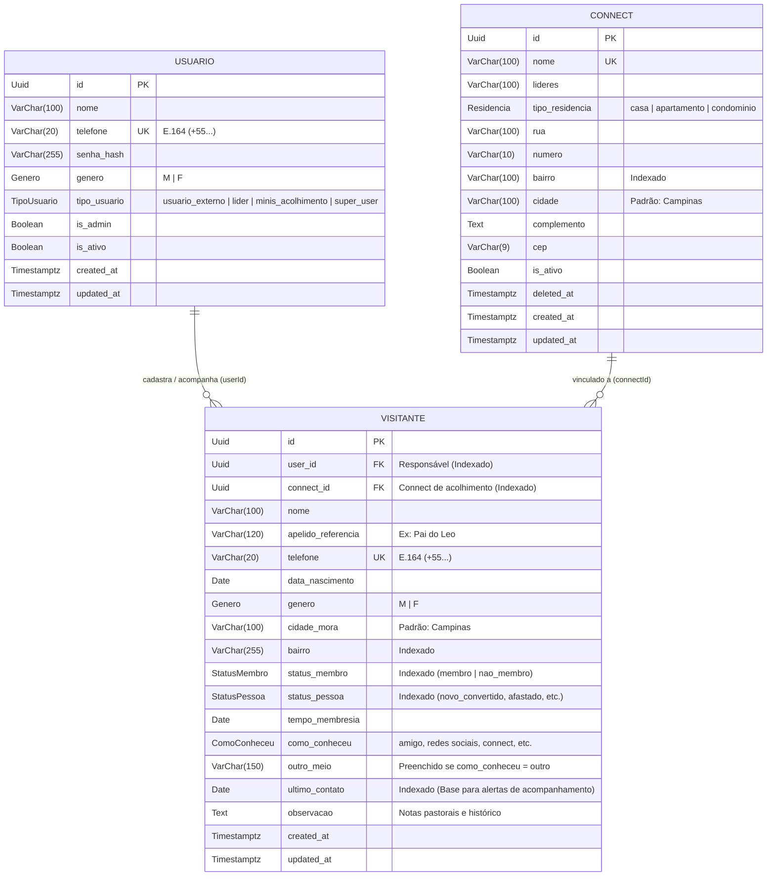
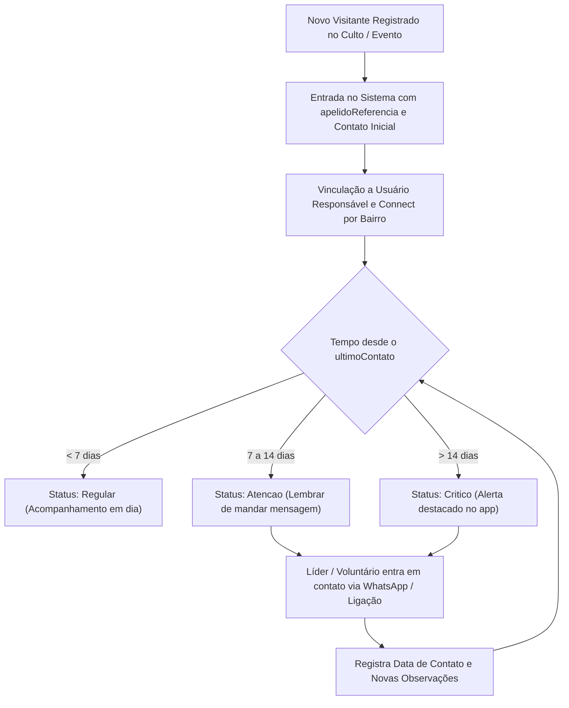

# MEVAM Contatos

> Sistema de gestão, acolhimento e rastreamento ativo de visitantes e contatos para a comunidade **MEVAM** (Campinas/SP), conectando pessoas a pequenos grupos (**Connects**) e assegurando que nenhum contato fique sem acompanhamento pastoral.

---

## 1. Objetivo do Projeto

O **MEVAM Contatos** foi idealizado para resolver uma dor recorrente em comunidades e igrejas: a perda de contato com pessoas que visitam a igreja ou participam de eventos. O sistema atua como uma ferramenta prática de acolhimento e discipulado, com os seguintes focos centrais:

1. **Rastreamento Ativo e Lembretes de Contato**:
   - Cada visitante cadastrado possui o registro da data do último contato (`ultimoContato`).
   - O sistema calcula e expõe a quantidade de dias sem contato (`diasSemContato`) e um nível de atenção (`statusAlerta`: `regular`, `atencao`, `critico`), permitindo identificar rapidamente quem precisa de uma ligação, mensagem ou visita pastoral.
   - Histórico contínuo de anotações (`observacao`) para registrar o contexto de cada conversa.

2. **Lembretes Visuais e Contextuais**:
   - Campo dedicado a apelidos e referências visuais (`apelidoReferencia`, ex: *"Pai do Leo"*, *"Camisa preta do culto da noite"*), garantindo que a equipe de acolhimento reconheça a pessoa de imediato.

3. **Integração com Pequenos Grupos (Connects)**:
   - Mapeamento de células/Connects por bairros e cidades com lideranças identificadas.
   - Direcionamento geográfico dos visitantes para os Connects mais próximos de suas residências.

4. **Termômetro Pastoral**:
   - Classificação do momento espiritual e institucional da pessoa (`statusPessoa`: novo convertido, afastado, em transição, liderança de outra igreja, etc.) e seu status de membresia (`statusMembro`: membro ou não membro).

5. **Acesso Multiperfil e Descentralizado**:
   - Controle de acesso baseado em cargos para voluntários de recepção, equipe de acolhimento, líderes de Connect e pastores/administradores.

---

## 2. Ferramentas e Stack Tecnológica

O ecossistema do projeto foi selecionado priorizando **baixo custo de manutenção**, **alta performance** e **segurança de tipos ponta a ponta (Type-Safety)**.

| Camada | Ferramenta / Biblioteca | Descrição e Finalidade |
| :--- | :--- | :--- |
| **Linguagem** | **TypeScript 7 / Node.js** (ES Modules) | Tipagem estática, manutenção segura e modernidade. |
| **Framework Backend** | **Fastify 5** | Servidor HTTP de altíssima performance e baixo consumo de memória. |
| **Validação de Schemas** | **Zod 4** + `@fastify/type-provider-zod` | Validação de payloads (body, query, params) e inferência automática de tipos nos endpoints. |
| **Banco de Dados & ORM** | **PostgreSQL 16** + **Prisma ORM 7** | Banco relacional robusto com queries tipadas via `@prisma/adapter-pg`. |
| **Autenticação & Segurança** | **`@fastify/jwt`** | Autenticação stateless via Bearer Tokens JWT (expiração de 7 dias). |
| **Normalização de Telefones** | **`libphonenumber-js`** | Validador e normalizador inteligente para o padrão internacional **E.164** (`+5519999998888`). |
| **Frontend (Definido)** | **React + Vite + TypeScript** | SPA responsiva Mobile-First, com prototipagem em andamento no **Figma**. |
| **Estilização & Componentes** | **Tailwind CSS + shadcn/ui** | Componentes acessíveis, responsivos e otimizados para toque no celular e densidade no PC. |
| **Distribuição Mobile** | **PWA (`vite-plugin-pwa`)** | Permite aos líderes e voluntários "baixar via web" (instalar na tela inicial do celular) sem custos de App Store. |
| **Contêineres Locais** | **Docker & Docker Compose** | Orquestração local do PostgreSQL e pgAdmin 4. |

---

## 3. Organização do Repositório (Monorepo)

O projeto é estruturado como um monorepo gerenciado via **pnpm workspaces**:

```text
mevam-contatos/
├── compose.yaml                    # Orquestração Docker (Postgres 16 + pgAdmin 4)
├── package.json                    # Configuração raiz do monorepo pnpm
├── pnpm-lock.yaml                  # Lockfile unificado de dependências
├── logicas_categorias.txt          # Especificação das regras de negócio por perfil
├── README.md                       # Documentação principal do projeto
│
├── frontend/                       # Aplicação Web Responsiva / PWA (Baseado nos layouts do Figma)
│   └── package.json                # Configuração do app cliente
│
└── backend/                        # API RESTful Fastify
    ├── package.json                # Dependências e scripts do servidor
    ├── tsconfig.json               # Configuração do TypeScript (NodeNext)
    ├── prisma7.config.ts           # Configuração de datasource e migrations do Prisma 7
    │
    ├── prisma/
    │   ├── schema.prisma           # Modelagem de dados e relacionamentos
    │   └── migrations/             # Histórico de migrações SQL versionadas
    │
    └── src/
        ├── server.ts               # Inicialização HTTP, plugins e rota /health
        ├── app.ts                  # Configuração da instância Fastify
        │
        ├── config/
        │   └── database.config.ts  # Configuração da conexão PrismaClient com PostgreSQL
        │
        ├── plugins/
        │   ├── auth.plugin.ts      # Plugin de JWT e decorador app.authenticate
        │   ├── database.plugin.ts  # Injeção de app.orm e graceful shutdown do Prisma
        │   └── phone.validator.ts  # Validador E.164 com libphonenumber-js integrado ao Zod
        │
        ├── types/
        │   └── fastify.d.ts        # Extensão de tipagens do Fastify e payload do JWT
        │
        ├── dtos/                   # Contratos de dados com Zod (Validação e Serialização)
        │   ├── auth.dto.ts         # Login e Payload JWT
        │   ├── usuario.dto.ts      # Criação, atualização e respostas de usuários
        │   ├── connect.dto.ts      # Criação, filtros paginados e respostas de Connects
        │   └── visitantes.dto.ts   # Gestão de visitantes, lembretes de contato e alertas
        │
        ├── services/               # Regras de negócio e comunicação com o banco de dados
        │   ├── auth.service.ts     # Autenticação e hash de senhas
        │   ├── user.service.ts     # Gestão de usuários e permissões
        │   ├── connect.service.ts  # Gestão e listagem de Connects
        │   └── visistante.service.ts # Gestão de visitantes e cálculo de status de contato
        │
        └── routes/                 # Controllers HTTP do Fastify com tipagem Zod
            ├── auth.controller.ts
            ├── user.controller.ts
            ├── connect.controller.ts
            └── visitantes.controller.ts
```

---

## 4. Regras de Acesso e Perfis de Usuário (RBAC)

O sistema define quatro perfis operacionais com responsabilidades bem delimitadas:

| Perfil (`TipoUsuario`) | Nível | Permissões no Sistema |
| :--- | :--- | :--- |
| `usuario_externo` | **Externo / Recepção** | Acesso limitado exclusivamente à **adição de novos contatos/visitantes**. Não visualiza nem altera Connects. |
| `minis_acolhimento` | **Membro / Acolhimento** | Visualiza Connects para direcionamento, cadastra e acompanha contatos, atualiza histórico de contato e edita o próprio perfil. |
| `lider` | **Líder de Connect** | Gestão de contatos de sua responsabilidade, atualização de dados do Connect, visualização de relatórios da sua área. |
| `super_user` (`isAdmin: true`) | **Administrador / Pastoral** | Acesso total e irrestrito: gestão de todos os usuários, Connects, contatos e configurações gerais. |

---

## 5. Modelo de Dados

O banco de dados relacional foi modelado com índices estratégicos para viabilizar consultas rápidas na tela de lembretes e filtros por localização geográfica:



---

## 6. Fluxo de Vida do Rastreamento de Contato



---

## 7. Como Executar o Projeto Localmente

### Pré-requisitos
- **Node.js** (versão 20 ou superior)
- **pnpm** (`npm install -g pnpm`)
- **Docker** e **Docker Compose**

### 1. Clonar e Instalar Dependências
```bash
git clone <url-do-repositorio>
cd mevam-contatos
pnpm install
```

### 2. Configurar Variáveis de Ambiente
Copie o arquivo de exemplo na raiz e no backend:
```bash
cp .env.example .env
```

### 3. Iniciar o Banco de Dados Local
Suba os contêineres do PostgreSQL e pgAdmin:
```bash
docker compose up -d
```

### 4. Executar Migrações do Prisma
```bash
cd backend
pnpm prisma migrate dev
```

### 5. Iniciar o Servidor Backend
```bash
pnpm dev
# Servidor rodará em http://localhost:3333 (ou na porta definida no .env)
```

Teste de saúde da API:
```bash
curl http://localhost:3333/health
```

---

## 8. Status Atual e Roadmap

- [x] Modelagem do banco de dados relacional e 4 migrações aplicadas ([schema.prisma](file:///home/tanaka/dev/projetos/personal/mevam-contatos/backend/prisma/schema.prisma)).
- [x] Configuração de Docker Compose para banco local ([compose.yaml](file:///home/tanaka/dev/projetos/personal/mevam-contatos/compose.yaml)).
- [x] Plugins transversais de banco (`app.orm`), JWT (`@fastify/jwt`) e validador E.164.
- [x] DTOs completos e tipados com Zod para Usuários, Connects, Visitantes e Autenticação.
- [ ] Correção de sintaxe e refinamento dos métodos em `ConnectService`.
- [ ] Implementação das regras de negócio de `VisitanteService`, `UserService` e `AuthService`.
- [ ] Registro dos controllers e compiladores do ZodTypeProvider no `server.ts`.
- [ ] **Frontend**: Recepção e implementação dos layouts prototipados no **Figma** em **React + Tailwind CSS + PWA**.
